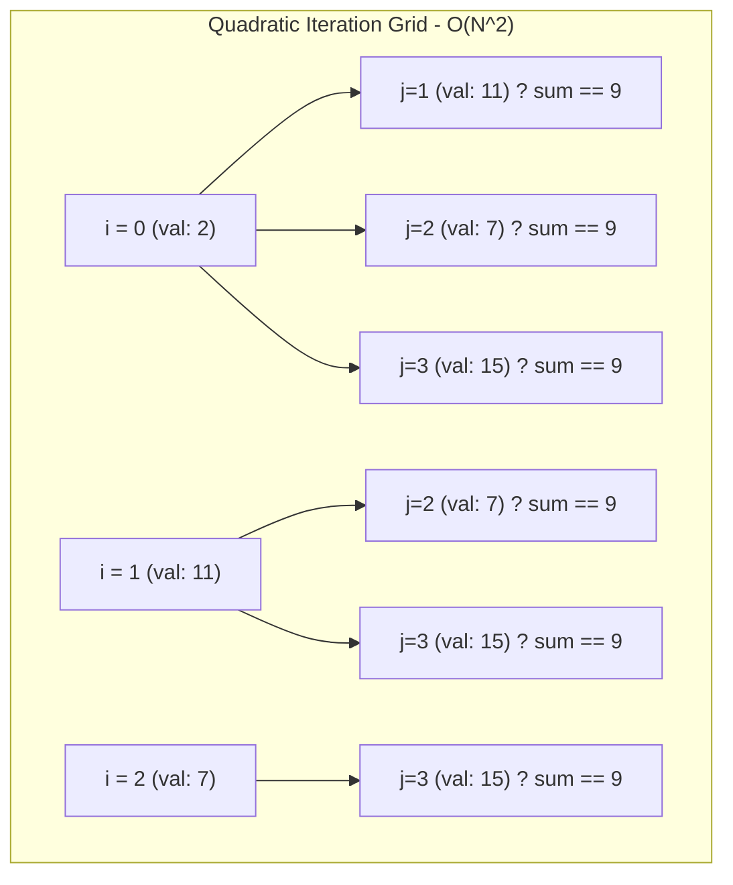
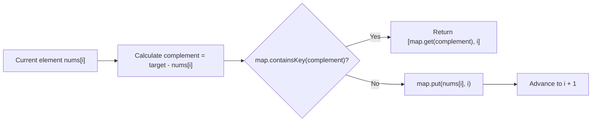

# 1. Two Sum (LeetCode)

- **Platform**: [LeetCode #1](https://leetcode.com/problems/two-sum/)
- **Difficulty**: Easy
- **Topic**: Arrays, Hash Table

---

## Problem Statement

Given an array of integers `nums` and an integer `target`, return indices of the two numbers such that they add up to `target`.

You may assume that each input would have exactly one solution, and you may not use the same element twice. You can return the answer in any order.

### Constraints
- $2 \le \text{nums.length} \le 10^4$
- $-10^9 \le \text{nums}[i] \le 10^9$
- $-10^9 \le \text{target} \le 10^9$
- Only one valid answer exists.

---

## 1. User Submission (Java)

```java
class Solution {
    public int[] twoSum(int[] nums, int target) {
        int n = nums.length;
        int arr[] = new int[2];
        for(int i = 0; i<n;i++){
            for(int j = i+1; j<n;j++){
                if(nums[i] + nums[j] == target){
                    arr[0] = i;
                    arr[1] = j;
                }
            }
        }
        return arr;
    }
}
```

### Analysis of the Submission
1. **Unnecessary Iterations**: If the answer is found at index `0` and `1`, the loops continue comparing every remaining pair $(i, j)$ until $i = n-1, j = n-1$.
2. **Quadratic Growth**: For an array of size $N$, the nested loop performs $\frac{N(N-1)}{2}$ comparisons.
3. **Scaling Bottleneck**: When $N = 10^4$, total operations $\approx 5 \times 10^7$. On platforms with strict $100\text{ ms}$ timeouts or larger constraints ($N = 10^5$), this triggers a Time Limit Exceeded (TLE).

---

## 2. Approach Comparison: Brute Force vs. Hash Map

| Metric | User Solution (Nested Loops) | Optimal Solution (One-Pass Hash Map) | Architectural Advantage |
|---|---|---|---|
| **Time Complexity** | $O(N^2)$ | $O(N)$ | Eliminates quadratic search space |
| **Space Complexity** | $O(1)$ | $O(N)$ | Trades memory for instantaneous lookups |
| **Worst-Case Operations ($N=10^4$)** | $\approx 50,000,000$ comparisons | $\le 10,000$ lookups + inserts | **$5000\times$ fewer operations** |
| **Search Mechanics** | Linear re-scan of remaining array | $O(1)$ average hash table bucket lookup | Converts nested iteration into dictionary check |
| **Early Exit** | Missing (runs to completion) | Immediate `return` on first match | Skips all remaining elements |

---

## 3. Visual Search Space Mechanics

### Approach A: Brute Force ($O(N^2)$ Pairwise Scan)

Each element re-scans all subsequent elements, producing a triangular search matrix:



### Approach B: Optimal ($O(N)$ Single Pass with Hash Map)

The hash map acts as an instant lookup ledger of previously seen numbers. For each number, we check if its required complement `target - nums[i]` already exists in the map:



---

## 4. Step-by-Step Execution Trace

Given: `nums = [2, 11, 7, 15]`, `target = 9`

| Step | Index ($i$) | Current Value (`nums[i]`) | Required Complement (`9 - nums[i]`) | Map State Before Check | Match Found? | Action Taken |
|:---:|:---:|:---:|:---:|:---:|:---:|---|
| **1** | `0` | `2` | `7` | `{}` | ❌ No | Add `2 -> 0` to map |
| **2** | `1` | `11` | `-2` | `{2: 0}` | ❌ No | Add `11 -> 1` to map |
| **3** | `2` | `7` | `2` | `{2: 0, 11: 1}` | ✅ **Yes** (`2` exists at index `0`) | **Return `[0, 2]` immediately** |

- Total steps taken: **3 iterations** (Brute force would perform 6 comparisons and still continue looping).

---

## 5. Optimal Implementation (Java)

```java
import java.util.HashMap;
import java.util.Map;

class Solution {
    public int[] twoSum(int[] nums, int target) {
        Map<Integer, Integer> map = new HashMap<>();

        for (int i = 0; i < nums.length; i++) {
            int complement = target - nums[i];
            if (map.containsKey(complement)) {
                return new int[] { map.get(complement), i };
            }
            map.put(nums[i], i);
        }

        return new int[] {};
    }
}
```

---

## 6. Python Implementation (Automation & Scripting)

```python
class Solution:
    def twoSum(self, nums: list[int], target: int) -> list[int]:
        seen = {}
        for i, num in enumerate(nums):
            complement = target - num
            if complement in seen:
                return [seen[complement], i]
            seen[num] = i
        return []
```

---

## 7. Edge Cases & Interview Follow-ups

| Scenario | Input Example | Expected Behavior / Handling |
|---|---|---|
| **Negative Numbers** | `nums = [-3, 4, 3, 90]`, `target = 0` | Math holds: `0 - (-3) = 3`. Map correctly matches `-3` and `3`. |
| **Duplicates as Components** | `nums = [3, 3]`, `target = 6` | At $i=0$, map stores `{3: 0}`. At $i=1$, complement `3` is found in map before overwriting. Returns `[0, 1]`. |
| **Large Value Range** | `nums[i] = 10^9` | Sum fits within standard 32-bit signed integer limits ($[-2 \times 10^9, 2 \times 10^9]$). |
